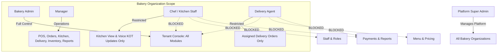

# Role-Based Access Control (RBAC) & Authorization — FlowDineOS

## 1. Role Scope Hierarchy

FlowDineOS enforces strict role scopes. Every user has a defined role within the organization.



---

## 2. Granular Permissions Catalog

Permissions in FlowDineOS are granular strings evaluated on both the API and client routes:

```text
dashboard.view        - View tenant analytics dashboard
menu.view             - View catalog categories and items
menu.create           - Create new products and variants
menu.update           - Edit pricing, descriptions, and images
menu.delete           - Archive or remove menu items
orders.view           - View customer and POS orders
orders.create         - Place orders via counter POS
orders.update         - Modify order status, notes, or items
kitchen.view          - Access the Kitchen Display screen
kitchen.update        - Update KOT ticket preparation statuses
delivery.view         - Access the Delivery Agent Dashboard
delivery.assign       - Assign delivery orders to drivers
delivery.update_status- Update delivery progress (PICKED_UP, DELIVERED)
staff.view            - List bakery team members
staff.create          - Invite and register new staff members
staff.update          - Modify staff roles or details
staff.deactivate      - Revoke staff organization membership
roles.view            - Inspect role definitions
roles.manage          - Create and modify custom role permission sets
website.view          - View public storefront settings
website.manage        - Configure hero text, announcements, layouts
brandkit.manage       - Modify brand colors, logos, and fonts
inventory.view        - View current stock counts and alerts
inventory.manage      - Adjust stock levels with mandatory reasons
reports.view          - Access sales, channel, and product reports
data.export           - Export tenant data to CSV/JSON
data.import           - Import product and category catalogs
settings.manage       - Update integration keys and business profile
audit.view            - Inspect security and operational audit logs
payments.view         - View payment records and transaction logs
payments.manage       - Record manual payments, refunds, and adjustments
```

---

## 3. Role-to-Permission Mapping Matrix

| Permission | Super Admin | Org Admin | Manager | Chef | Delivery Agent |
| :--- | :---: | :---: | :---: | :---: | :---: |
| `platform.manage` | ✅ | ❌ | ❌ | ❌ | ❌ |
| `dashboard.view` | ✅ | ✅ | ✅ | ❌ | ❌ |
| `menu.view` | ✅ | ✅ | ✅ | ✅ | ❌ |
| `menu.manage` | ✅ | ✅ | ✅ | ❌ | ❌ |
| `orders.view` | ✅ | ✅ | ✅ | ✅ | ❌ |
| `orders.create` | ✅ | ✅ | ✅ | ❌ | ❌ |
| `kitchen.view` | ✅ | ✅ | ✅ | ✅ | ❌ |
| `kitchen.update` | ✅ | ✅ | ✅ | ✅ | ❌ |
| `delivery.view` | ✅ | ✅ | ✅ | ❌ | ✅ |
| `delivery.assign` | ✅ | ✅ | ✅ | ❌ | ❌ |
| `delivery.update_status` | ✅ | ✅ | ✅ | ❌ | ✅ |
| `staff.manage` | ✅ | ✅ | ❌ | ❌ | ❌ |
| `roles.manage` | ✅ | ✅ | ❌ | ❌ | ❌ |
| `website.manage` | ✅ | ✅ | ❌ | ❌ | ❌ |
| `brandkit.manage` | ✅ | ✅ | ❌ | ❌ | ❌ |
| `inventory.view` | ✅ | ✅ | ✅ | ✅ | ❌ |
| `inventory.manage` | ✅ | ✅ | ✅ | ❌ | ❌ |
| `reports.view` | ✅ | ✅ | ✅ | ❌ | ❌ |
| `data.export` | ✅ | ✅ | ✅ | ❌ | ❌ |
| `data.import` | ✅ | ✅ | ❌ | ❌ | ❌ |
| `payments.manage` | ✅ | ✅ | ✅ | ❌ | ❌ |
| `audit.view` | ✅ | ✅ | ❌ | ❌ | ❌ |
