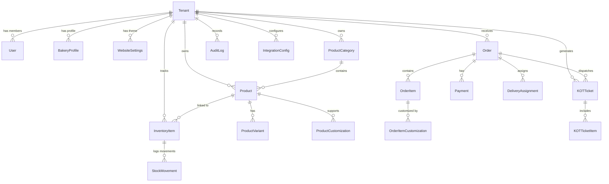

# Database Design Specification

## 1. Multi-Tenant Data Modeling Strategy
BMS utilizes a **Shared Database, Logical Tenant Isolation** architecture. Every tenant-specific table contains a non-nullable `tenantId` column that references `Tenant(id)`. 

### Key Constraints & Indexes:
- Compound indexes for tenant-scoped lookups: `@@index([tenantId, createdAt])`, `@@index([tenantId, status])`.
- Unique constraints scoped to tenant: `@@unique([tenantId, slug])` for categories and items.
- High-precision monetary fields: Decimal columns (`Decimal(10, 2)`) to eliminate floating-point calculation errors.

---

## 2. Entity-Relationship Diagram (ERD)

---

## 3. Core Entities Detail

### 3.1 Tenant & Access Control
- `Tenant`: Core bakery entity (`id`, `name`, `slug`, `isActive`, `createdAt`, `updatedAt`).
- `BakeryProfile`: Contact information, address, tax/GST number, currency, timezone, opening hours.
- `WebsiteSettings`: Hex color codes (primary, secondary, background, card, header, button, text, heading), font family, hero banner images, social links.
- `User`: Application user linked to tenant memberships.
- `TenantMembership`: Role mapping (`SUPER_ADMIN`, `BAKERY_ADMIN`, `POS_STAFF`, `KITCHEN_STAFF`, `DELIVERY_STAFF`).

### 3.2 Product Catalog & Custom Cake Builder
- `ProductCategory`: Category hierarchy (`Bread`, `Pastries`, `Cakes`, `Customized Cakes`, `Cookies`, etc.).
- `Product`: Item details, base price, tax rate, stock tracking flag, preparation time, ImageKit URL.
- `ProductVariant`: Size (e.g. "0.5kg", "1kg", "Regular", "Large"), price delta, SKU.
- `ProductCustomization`: Configurable options for customized cakes (Flavours, Shapes, Tiers, Cream/Frosting, Sponge type).

### 3.3 Orders & POS
- `Order`: Order number, order source (`POS`, `PUBLIC_WEBSITE`, `WHATSAPP`), status (`NEW`, `ACCEPTED`, `PREPARING`, `READY_FOR_PICKUP`, `OUT_FOR_DELIVERY`, `DELIVERED`, `CANCELLED`), delivery type (`PICKUP`, `DELIVERY`), customer info, delivery address, financial totals (subtotal, discount, tax, total, paidAmount, balanceAmount).
- `OrderItem`: Snapshot of product name, unit price, quantity, special instructions.
- `OrderItemCustomization`: Specific custom cake specifications (e.g., photo URL, custom greeting message, flavour choice).

### 3.4 Payments & Receipts
- `Payment`: Amount, method (`CASH`, `UPI`, `CARD`, `CREDIT`), status (`PENDING`, `COMPLETED`, `FAILED`, `REFUNDED`), transaction reference ID, recorded by user.
- `PrintJob`: Receipt and KOT print requests, format (`ESC_POS_80MM`, `ESC_POS_58MM`), print status (`PENDING`, `PRINTED`, `FAILED`).

### 3.5 Kitchen Display System & Voice Queue
- `KOTTicket`: Ticket number, order reference, station (`BAKERY`, `DECORATION`, `HOT_KITCHEN`), status (`NEW`, `ACCEPTED`, `PREPARING`, `READY`, `COMPLETED`), priority, announced timestamp.
- `KOTTicketItem`: Line items for kitchen ticket with preparation notes.

### 3.6 Inventory & Stock Movements
- `InventoryItem`: Current stock quantity, low-stock threshold, unit of measurement (pieces, kg, grams).
- `StockMovement`: Timestamped movement history, change amount (+/-), movement reason (`ORDER_SALE`, `MANUAL_CORRECTION`, `EXPIRED`, `SPOILED`, `RESTOCK`), recorded by user.

### 3.7 Integrations, Notifications & Auditing
- `IntegrationConfig`: Encrypted credentials per tenant (Interakt WhatsApp API key, ImageKit keys, thermal printer configs).
- `Notification`: Outbox pattern for WhatsApp messages (`type`, `recipientPhone`, `payload`, `status`, `retryCount`).
- `AuditLog`: Action name, entity type, entity ID, previous state, new state, user ID, IP address.
