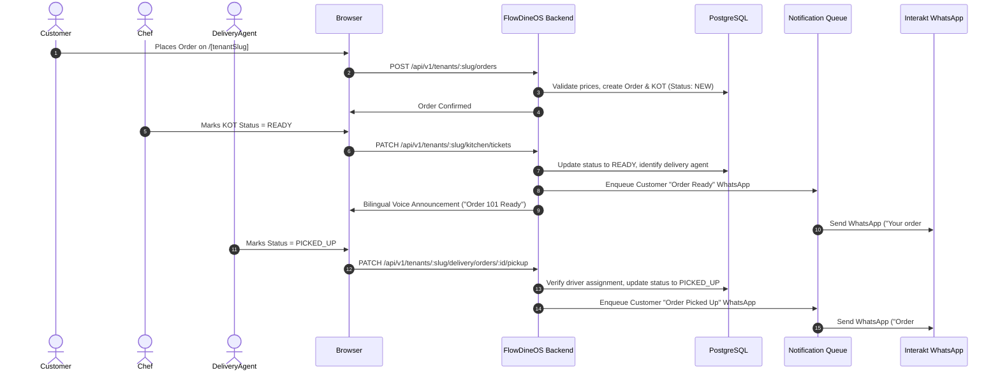

# System Architecture — FlowDineOS

## 1. High-Level Architecture Overview

FlowDineOS is architected as a modular, multi-tenant SaaS application running Next.js (App Router), TypeScript, Prisma ORM, and PostgreSQL. It delivers distinct entry portals for Platform Super Admin, Tenant Administrators, Public Storefront Visitors, Kitchen Staff, and Delivery Agents.

```mermaid
graph TD
    Client[Web & Mobile Browsers] --> Ingress[Reverse Proxy / Next.js Server]
    
    subgraph Routing & Portals
        Ingress --> SuperAdmin[Platform Super Admin: /super-admin]
        Ingress --> PublicStore[Dynamic Bakery Storefront: /[tenantSlug]]
        Ingress --> TenantAdmin[Tenant Console: /admin/[tenantSlug]]
        Ingress --> KitchenDisplay[Kitchen Display & Voice KOT: /kitchen/[tenantSlug]]
        Ingress --> DeliveryPortal[Delivery Agent Dashboard: /delivery/[tenantSlug]]
    end

    subgraph Core Services & Middleware
        Auth[Clerk / Session RBAC Guard]
        TenantResolver[Tenant Resolution & Isolation Middleware]
        OrderEngine[Order & KOT Lifecycle Service]
        Realtime[Socket.IO Real-time Broadcaster]
        OutboxWorker[WhatsApp Notification Outbox Engine]
    end

    TenantAdmin --> Auth
    KitchenDisplay --> Auth
    DeliveryPortal --> Auth
    SuperAdmin --> Auth

    Auth --> TenantResolver
    TenantResolver --> OrderEngine
    OrderEngine --> Realtime
    OrderEngine --> OutboxWorker

    subgraph Data & Storage
        DB[(Railway PostgreSQL: Prisma ORM)]
        ImageStorage[ImageKit CDN]
    end

    OrderEngine --> DB
    TenantResolver --> DB

    subgraph External Integrations
        OutboxWorker --> Interakt[Interakt WhatsApp API]
        Realtime --> LocalPrintAgent[FlowDineOS LAN Print Agent]
    end
```

---

## 2. Multi-Tenant Flow & Request Lifecycle



---

## 3. Core Component Boundaries

### 3.1 Super Admin Module
- **Organization Provisioning**: Creates tenant records, initializes bakery profile, default website theme, and creates initial organization administrator.
- **Platform Health & Metrics**: Displays platform-wide tenant counts, order volumes, and system audit logs.

### 3.2 Dynamic Storefront Renderer
- Shared dynamic layout matching `/[tenantSlug]`.
- Reads `WebsiteSettings` and `BakeryProfile` to apply tenant-specific brand tokens dynamically (CSS variables for primary, secondary, card, background, text colors).
- Embeds a **Staff Login** action button leading to tenant role authentication.

### 3.3 Kitchen View & Voice Queue
- Displays real-time tickets with visual status progression (`NEW` -> `ACCEPTED` -> `PREPARING` -> `READY` -> `COMPLETED`).
- Bilingual speech generation (English + Telugu) via Web Speech API with duplicate speech suppression.

### 3.4 Delivery-Agent Dashboard
- Dedicated, secure interface for delivery agents (`/delivery/[tenantSlug]`).
- Strictly isolated: drivers only view orders assigned to them or unassigned ready orders for pickup.
- One-click status triggers: `PICKED_UP` and `DELIVERED`.

### 3.5 Interakt WhatsApp Notification Subsystem
- Authoritative database operations succeed independently of external HTTP availability.
- Durable Outbox pattern stores notification jobs in PostgreSQL (`Notification` model) with retry tracking, template parameters, and error logs.
