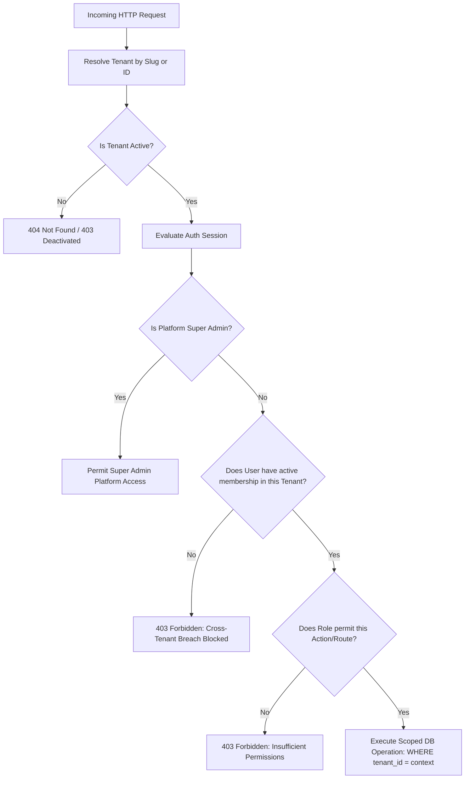

# Multi-Tenant Isolation Strategy — FlowDineOS

## 1. Principles of Tenant Isolation

In FlowDineOS, multi-tenancy is enforced with the following guarantees:
1. **Server-Side Enforcement**: Tenant boundaries are enforced in the API layer and repository layer. Hiding a button or menu item in the frontend is never treated as authorization.
2. **Context Binding**: The authenticated user's active session is cryptographically bound to their `userId` and `tenantId`.
3. **No Cross-Tenant Querying**: Every database query on tenant-owned entities strictly includes `WHERE tenant_id = :activeTenantId`.
4. **URL Slug Verification**: The URL slug (e.g. `/admin/sweet-delights`) must match the resolved tenant of the user's active membership. A staff member of Bakery A navigating to `/admin/crumb-crust` is rejected with HTTP 403 Forbidden.

---

## 2. Protected Entities Scoped by Tenant
Every tenant-owned model in `prisma/schema.prisma` contains a mandatory `tenantId` foreign key:
- `BakeryProfile`
- `WebsiteSettings`
- `TenantMembership`
- `ProductCategory`
- `Product`
- `Customer`
- `Order`
- `OrderItem`
- `Payment`
- `KOTTicket`
- `InventoryItem`
- `StockMovement`
- `DeliveryAssignment`
- `Notification`
- `IntegrationConfig`
- `PrintJob`
- `AuditLog`

---

## 3. Defense Against Cross-Tenant Attacks

### 3.1 ID Guessing / Enumeration Attack
- **Attack**: A malicious user at Bakery A changes `orderId` in a PATCH request to modify Bakery B's order.
- **Defense**: All updates verify `WHERE id = :orderId AND tenant_id = :sessionTenantId`. If no record matches both, an error is returned.

### 3.2 Slug Manipulation Attack
- **Attack**: A staff member authenticated to `sweet-delights` modifies the URL to `/admin/crumb-crust/inventory`.
- **Defense**: Server-side middleware verifies that `user.memberships` contains an active record for `crumb-crust`. Because no such record exists, access is refused immediately.

### 3.3 Import / Export Leaks
- **Attack**: Bakery A attempts to export orders without specifying date bounds or attempts to upload Bakery B's products.
- **Defense**: The export endpoint enforces `WHERE tenant_id = :sessionTenantId`. The import endpoint assigns `tenantId = :sessionTenantId` to all parsed rows on the server, ignoring any tenant identifiers present in the uploaded file.
