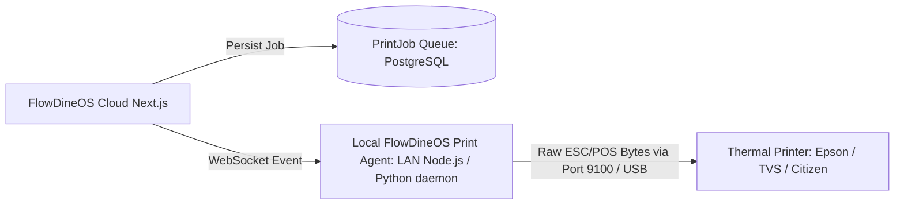

# Thermal Printing Integration & LAN Print Architecture

## 1. Overview
FlowDineOS supports standard 80mm and 58mm ESC/POS thermal receipt printers for counter receipts and kitchen order tickets (KOT).

## 2. Production Architecture

### Constraints:
- Cloud web applications running in modern browsers cannot directly open TCP raw sockets to local network IPs (e.g. `192.168.1.100:9100`) due to browser sandbox and CORS/mixed-content restrictions.
- Production installations use the lightweight **FlowDineOS Local Print Agent** running on the local store POS machine.
- For local browser testing and rapid previewing, FlowDineOS includes a built-in **Thermal Receipt Emulator** modal rendering authentic monospace receipt typography with copy/print triggers.

## 3. Print Job Lifecycle & Statuses
- `PENDING`: Formatted ESC/POS job queued in database.
- `DELIVERED_TO_AGENT`: Print agent retrieved job payload.
- `DELIVERED_TO_PRINTER`: Local printer confirmed receipt of buffer.
- `FAILED`: Connection timeout or paper-out status recorded.
- `CANCELLED`: User or manager revoked queue item.
